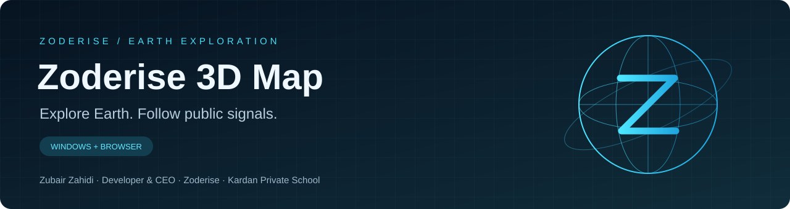
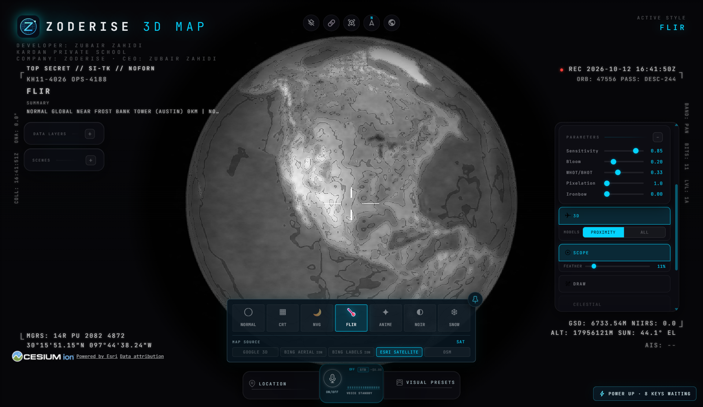
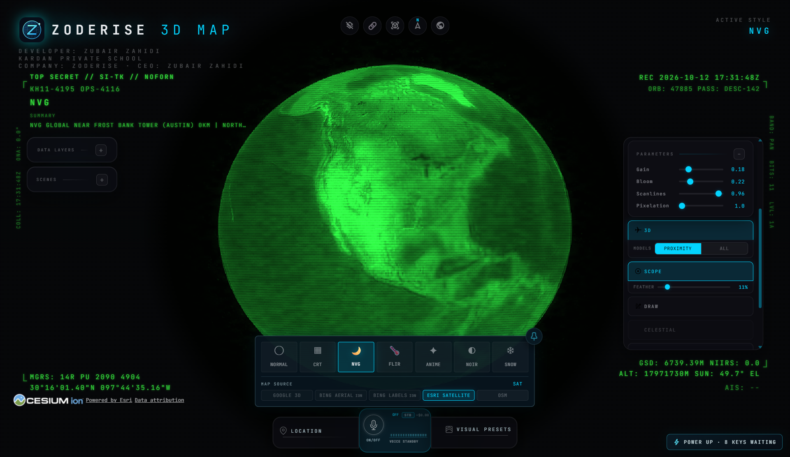
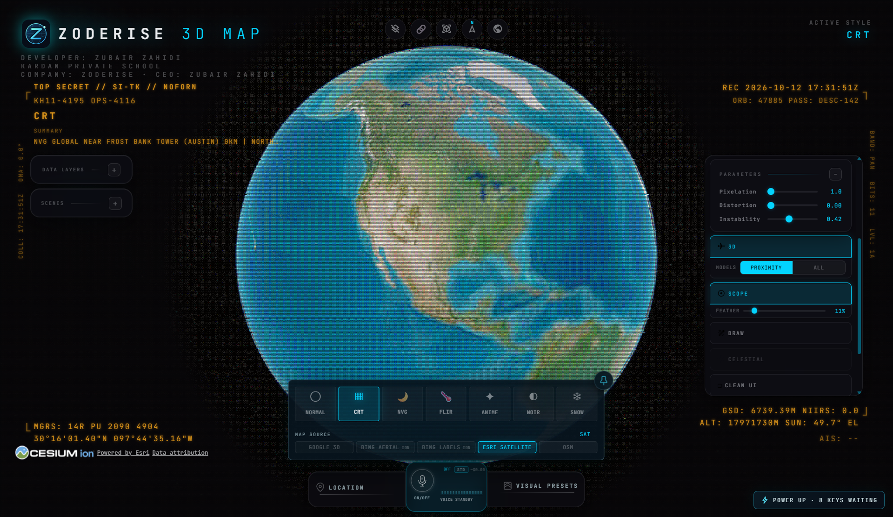

<div align="center">


# Zoderise 3D Map

Explore Earth in 3D, follow public live data, and switch between cinematic map styles.

[](https://github.com/Zubair-zahidi/zoderise-3d-map/actions/workflows/ci.yml)
[](https://github.com/Zubair-zahidi/zoderise-3d-map/actions/workflows/windows-release.yml)
[](LICENSE)

**Zoderise · Developer & CEO: Zubair Zahidi · Kardan Private School**

**[Download for Windows](https://github.com/Zubair-zahidi/zoderise-3d-map/releases/latest)** · [Getting started](docs/QUICK_START.md) · [Screenshot gallery](docs/GALLERY.md) · [Developer guide](docs/DEVELOPMENT.md)


</div>

## Choose your starting point

| I want to… | Start here |
|---|---|
| Use the app without developer tools | [Download the portable Windows application](https://github.com/Zubair-zahidi/zoderise-3d-map/releases/latest) |
| See the interface and visual styles | [Browse actual application screenshots](docs/GALLERY.md) |
| Configure my own optional providers | [Provider setup](#use-your-own-api-keys) |
| Run or build the project myself | [Developer guide](docs/DEVELOPMENT.md) |
| Check a downloaded release | [Release and checksum guide](docs/RELEASES.md) |

## Features

- Interactive 3D Earth, city and landmark search, and a full-globe reset.
- Public aircraft, satellites, earthquakes, cameras and other available data layers.
- Normal, thermal, night-vision, retro, anime, noir and snow visual styles.
- Scene tools, tracking and optional voice control.
- Portable Windows application that runs without Node.js or an editor.

Nineteen layers and map sources. **Seventeen have a keyless path.**

**Sits on the real ground.** Entity heights are aligned to work with Google 3D tiles, so aircraft park on aprons and cameras stand on street corners instead of floating.

Use DISPLAY ▸ **Draw** to annotate the map with shapes and routes. See the detailed guide for drawing controls and scene tools.

Feed coverage varies. Some layers are simulated or estimated; see [data sources](DATA_SOURCES.md). Optional photorealistic 3D services require your own provider credentials.

## Windows application

1. Download **Zoderise-3D-Map-1.0.0-x64.exe** from [Releases](https://github.com/Zubair-zahidi/zoderise-3d-map/releases/latest).
2. Double-click it on Windows x64. No developer platform or installation is required.
3. Choose **Explore manually**, then **Reset Globe** for a full-Earth view.
4. Scroll or pinch the touchpad to zoom. The app opens maximized with the interface at 100% scale.
5. Open **POWER UP** to configure your own optional providers.

Internet access and a graphics-capable computer are needed for online imagery and feeds. The executable is unsigned, so Windows may display an unknown-publisher warning. Download it from this repository's releases.

## Use your own API keys

**No personal Cesium ion token or other personal API key is included in the repository or portable build.** Keyless imagery works at startup.

| Provider | Optional capability | Environment setting |
|---|---|---|
| Cesium ion | Ion imagery, terrain and eligible 3D assets | CESIUM_ION_TOKEN |
| Google Maps | Direct photorealistic tiles and supported search | GOOGLE_MAPS_API_KEY |
| OpenAI | Voice control | OPENAI_API_KEY |
| Other feeds | Additional provider capabilities | See .env.example |

Open **POWER UP**, enter your own key and save. Desktop settings are stored in your application-data directory. Source users can copy **.env.example** to **.env** and fill in the services they need. Never commit or share .env.

Cesium and Google browser credentials are visible to the local browser by design; scope them appropriately. Provider accounts, quotas and terms apply. See [security guidance](SECURITY.md).

## Run from source

Use **Node.js 24.14+ within 24.x, or 26.x**, with npm.

```sh
git clone https://github.com/Zubair-zahidi/zoderise-3d-map.git
cd zoderise-3d-map
npm ci
npm run dev
```

Open the local URL printed by Vite. Keys are optional at startup. For optional environment configuration:

```powershell
# Windows PowerShell
Copy-Item .env.example .env
```

```sh
# macOS / Linux
cp .env.example .env
```

Edit .env locally, or use in-app provider settings.

## Build the Windows executable

Run on Windows from the repository root:

```sh
npm ci
npm --prefix desktop ci
npm run desktop:build
```

The executable is created in **release/**. Share the .exe alone. The desktop build uses credential placeholders; recipients provide their own keys at runtime. Generated builds, dependencies, logs and credentials are excluded from Git.

For a browser production build, run **npm run build**, then **npm run preview**. Browser builds use browser-provider settings at build time: do not publish a bundle containing personal credentials.

## Screenshots

Actual desktop captures using keyless map imagery:

| Earth exploration | Thermal visual style |
|---|---|
|  |  |

| Night-vision visual style | Retro visual style |
|---|---|
|  |  |

[View the full gallery, including anime, noir and provider settings →](docs/GALLERY.md)

## Troubleshooting

- **Globe too low or interface too large:** use the latest release, maximize the window and select Reset Globe.
- **Imagery or feeds missing:** check internet connectivity and provider availability; try keyless imagery.
- **Optional 3D missing:** configure your own eligible Cesium ion token or Google Maps key in POWER UP.
- **Install fails:** check Node.js and run **npm run doctor**.
- **Desktop build fails:** install dependencies in both the root and desktop directories.

Report bugs in [Issues](https://github.com/Zubair-zahidi/zoderise-3d-map/issues) with the app version, Windows version and reproduction steps. Do not include API keys.

## Documentation and attribution

| Guide | What it covers |
|---|---|
| [Quick start](docs/QUICK_START.md) | Download, first launch, navigation and provider setup |
| [Screenshot gallery](docs/GALLERY.md) | Actual captures and visual-style examples |
| [Development](docs/DEVELOPMENT.md) | Source setup, project structure, checks and packaging |
| [Releases](docs/RELEASES.md) | Portable distribution, checksums and updates |
| [Detailed inherited guide](docs/UPSTREAM_GUIDE.md) | Extended map features and upstream walkthroughs |
| [Data sources](DATA_SOURCES.md) | Feed coverage, estimates and data attribution |
| [Contributing](CONTRIBUTING.md) / [Testing](TESTING.md) | Contribution and verification workflows |
| [Security](SECURITY.md) / [Third-party notices](THIRD_PARTY_NOTICES.md) | Credential handling and dependency attribution |

Zoderise branding and desktop distribution are maintained by **Zubair Zahidi**, developer and CEO of **Zoderise**, with **Kardan Private School** named in the app credits.

Based on [God's Eye View by Bilawal Sidhu](https://github.com/bilawalsidhu/gods-eye-view). The original map implementation is retained. The MIT copyright remains in [LICENSE](LICENSE). Assets and datasets retain their own licenses. The inherited guide and media describe the upstream project and may show its original branding.
