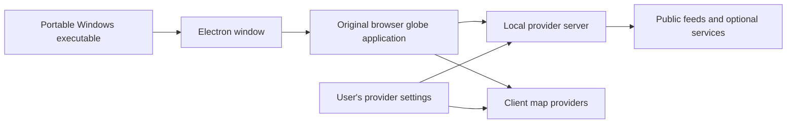

# Developer guide

[← Project overview](../README.md) · [Contribution guide](../CONTRIBUTING.md) · [Testing reference](../TESTING.md)

## Requirements and setup

Use Node.js **24.14+ in the 24.x line, or 26.x**, with npm. Windows is required for the documented Windows packaging path.

```sh
git clone https://github.com/Zubair-zahidi/zoderise-3d-map.git
cd zoderise-3d-map
npm ci
npm run dev
```

Open the local address printed by Vite. The app can start without personal API keys. For optional configuration, copy `.env.example` to `.env` and supply your own credentials, or use POWER UP.

## Project structure

| Directory | Responsibility |
|---|---|
| `src/` | Globe application, UI, camera, layers, effects and voice integration |
| `server/` | Local provider endpoints and server-side integrations |
| `build/` | Browser build configuration and response-header policies |
| `public/` | Static assets, branding and bundled public resources |
| `config/` | Source configuration, including public-camera definitions |
| `desktop/` | Electron wrapper, preparation and portable packaging |
| `docs/` | Guides, screenshots and architectural references |
| `.github/workflows/` | CI checks and the manually triggered Windows release |

## How the desktop application fits together



The wrapper serves the built browser application and local provider endpoints on loopback. Server-side credentials remain on the local machine; browser map providers use their scoped credentials in the renderer. The renderer has Node integration disabled. See [security](../SECURITY.md) for the full model.

## Verification

```sh
npm run doctor
npm run format:check
npm run check:boundaries
npm test
npm run build
```

CI checks supported Node versions and Windows onboarding. Consult [TESTING.md](../TESTING.md) for additional feature-specific and camera regression checks.

## Build a portable Windows application

```sh
npm ci
npm --prefix desktop ci
npm run desktop:build
```

The preparation script installs the Electron runtime when needed, builds browser assets with credential placeholders, copies the runtime modules and generates the Windows icon. Packaging produces the portable executable in `release/`.

Do not ship a private `.env`. Users configure their own credentials after launch. A regular browser build can include your configured client map credentials, so inspect that configuration before distributing browser assets.

## Publish a release

Maintainers can run **Actions → Windows release → Run workflow**. This workflow builds from the selected ref, checks portable startup, generates SHA-256 checksums and publishes the desktop version as a release. It is manually triggered and uses repository write permission for release publication.

The release tag comes from `desktop/package.json`. Choose a new version before publishing another release. Keep the release notes and download instructions synchronized with the version.

## Attribution

Zoderise retains the original God's Eye View map implementation and upstream MIT copyright. Preserve [LICENSE](../LICENSE), [THIRD_PARTY_NOTICES.md](../THIRD_PARTY_NOTICES.md) and the applicable dataset attribution when distributing changes.
