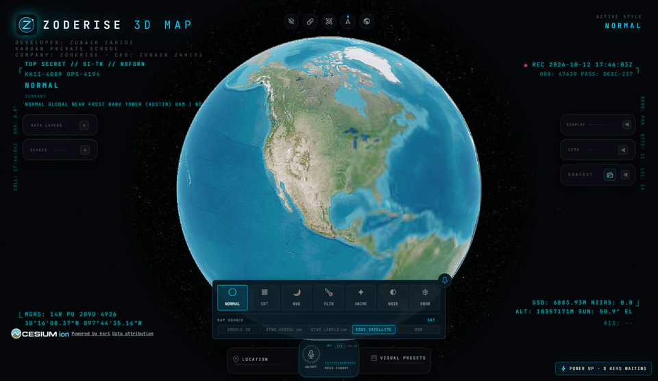
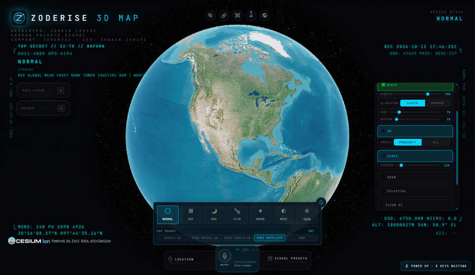
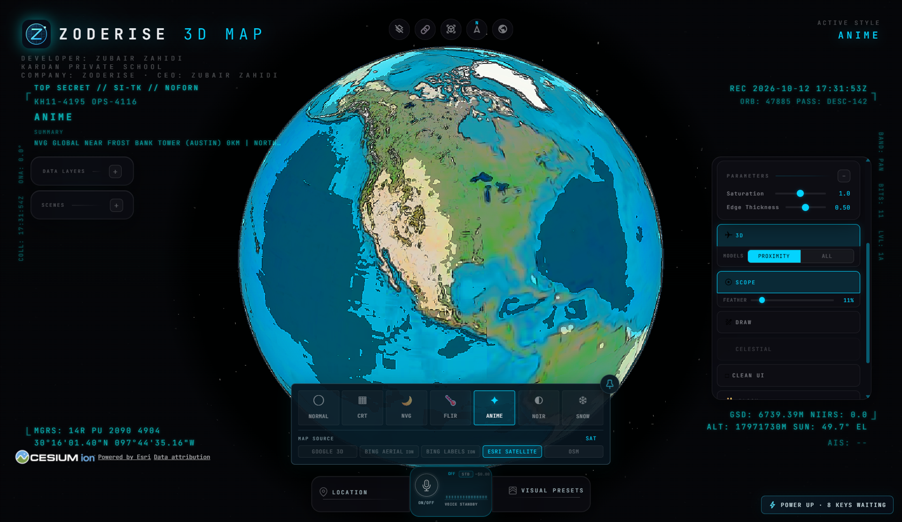
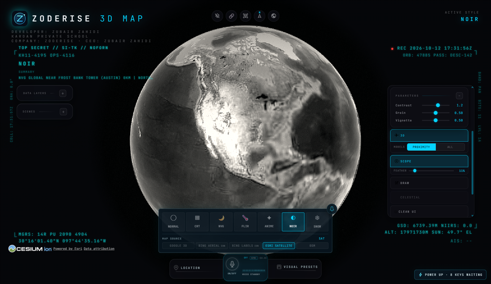

# Application screenshot gallery

[← Project overview](../README.md) · [Download for Windows](https://github.com/Zubair-zahidi/zoderise-3d-map/releases/latest)

Actual captures of Zoderise 3D Map using keyless imagery and no configured personal provider credentials. These show the application interface, rather than concept mockups. NVG and FLIR are visual styles, not real sensor readings.

## Animated style preview

Watch the actual application switch between its existing map styles.

## Animated zoom preview

The original map controls zoom in and out in a recorded desktop session.

## Earth exploration

The full globe with the Zoderise interface, navigation controls and public map attribution.

## FLIR style

A monochrome thermal-style treatment with the display parameters open.

## Night-vision style

Green intensification and a vignette for a night-vision-inspired appearance.

## Retro style

A phosphor-display-inspired treatment of the same map.

## Anime style

A bright, illustrated treatment of the globe.

## Noir style

Monochrome grading for a different way to view the same scene.

## Configure your own providers

The POWER UP panel explains optional provider capabilities and lets each user supply their own credentials. No personal keys are shown in this capture.

