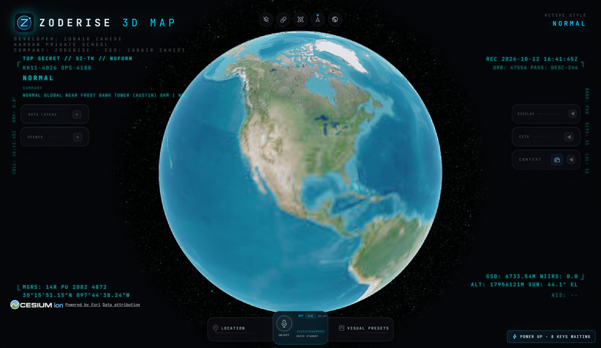
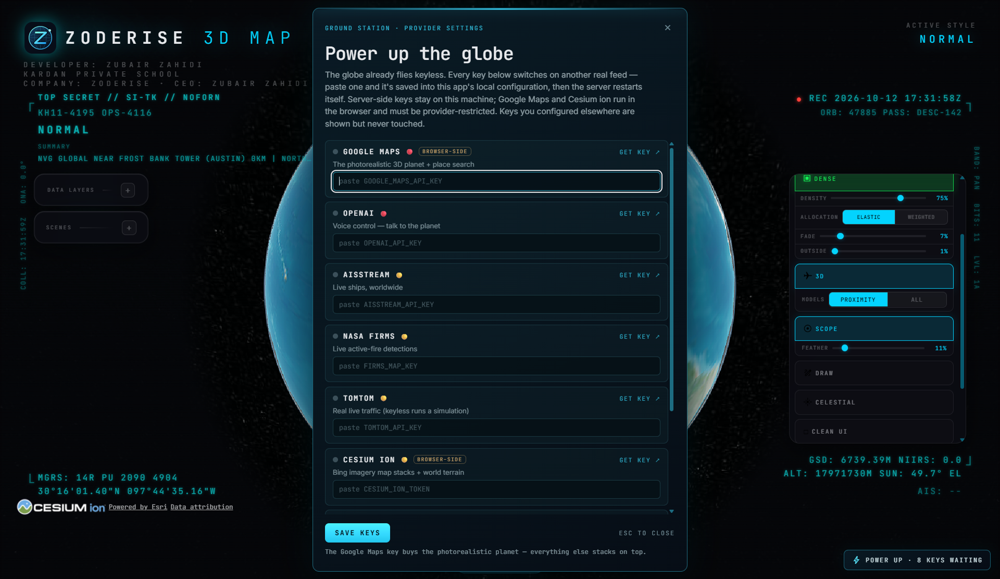

# Start exploring with Zoderise 3D Map

[← Project overview](../README.md) · [Download for Windows](https://github.com/Zubair-zahidi/zoderise-3d-map/releases/latest)

## 1. Download and open

From the official release, download **Zoderise-3D-Map-1.0.0-x64.exe**. Double-click it on Windows x64. The portable application includes its runtime; Node.js, npm and an editor are not required.

Keep an internet connection for online imagery and feeds. The current executable is unsigned, so Windows may show an unknown-publisher prompt. See the [checksum guide](RELEASES.md) to verify a download.

## 2. Choose your first view

Choose **Explore manually** in the welcome panel. Select **Reset Globe** to see the full Earth, then scroll or pinch your touchpad to zoom. Drag the map to explore, or search for a city, landmark or coordinates.

## 3. Explore the controls

| Control | What to try |
|---|---|
| Data Layers | Enable a public feed and inspect its coverage |
| Display | Switch visual styles and display options |
| Visual Presets | Try Normal, Retro, NVG, FLIR, Anime or Noir |
| Location | Search for a place or coordinates |
| Reset Globe | Return to the full-Earth view |
| POWER UP | Add your own optional provider credentials |

The NVG and FLIR views are visual effects, rather than actual night-vision or thermal sensor observations. Feed availability varies, and some layers contain simulation or estimated positions; see [data sources](../DATA_SOURCES.md).

## 4. Add optional capabilities

The application starts with keyless imagery. Open **POWER UP** to add your own Cesium ion token, Google Maps key or other supported provider credentials. Read the provider-specific description, enter the key and save. Restart or reload if the interface requests it.

No personal credentials are distributed with the project. Desktop settings stay in your application-data directory. Do not share credential files. Browser-used Cesium and Google credentials should be scoped appropriately; see [security guidance](../SECURITY.md).

## Need help?

For a cropped globe, maximize the app and use Reset Globe. For missing imagery, check connectivity and try the keyless map source. For optional photorealistic 3D, check your provider configuration and account eligibility.

If a problem persists, [report an issue](https://github.com/Zubair-zahidi/zoderise-3d-map/issues) with your app version, Windows version and reproduction steps. Remove credentials from logs or screenshots before posting.
